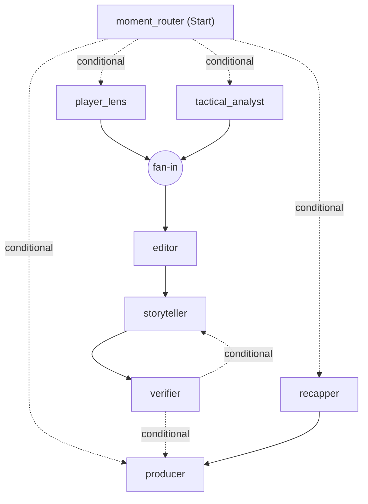

# Databall Live

Explainable match intelligence for the football the camera doesn't show: off-the-ball runs, pressing and space,
linked to the passes and shots they cause. Built for the Microsoft x Premier League *Inside the Game* hackathon. All
data is synthetic and every club and player is fictional.

**Live demo:** https://databall-live.purplegrass-00b787a0.swedencentral.azurecontainerapps.io

## Try it

Pick "Larkspur United v Harbour FC · The decoy", drag the timeline to the 40th minute and press play at 5x.

- **Fan**: insights pop up as they happen. Open Replay on a card for a 3D scene, repost it as an image, answer the
  live polls. The tabs hold the **Match** centre (live text and event maps), **Fantasy** (live points for every
  player, star your own) and **Predict & win** (a leaderboard for everyone in the room with club prizes).
- **Analyst**: every moment explained (what happened, why, what it led to), "See it on the pitch", the match rhythm,
  live pass quality, both clubs against their season, event maps and live text side by side.
- **Player focus**: one player against their season, with a player cam that follows them.
- **Producer**: the graphics on air and the packet behind them. Switch to "Approve before air", or cut the model and
  watch templates keep airing.
- Switch the language in the top bar: English, Spanish, German, French or Estonian.

Each browser gets its own broadcast room, so judges do not share a clock. The room is seeded with a simulated crowd,
so a lone viewer still has rivals on the leaderboard.

## How it answers the brief

| Brief | Where it lives |
| --- | --- |
| (a) Ingest events as they happen | Each match plays on a clock and streams every pass, shot, tackle, recovery, pressure and possession change to the **Input** panel, beside the 22-player tracking on a 3D broadcast camera |
| (b) Interpret into statistics and patterns | The stats engine (runs, decoys, pressing, gaps, overloads, chains, pitch control, xPass, xG) streams its detections next to the events, with live pass quality, speeds, fantasy points and event maps, and every match compared with the season so far |
| (c) Explain why a moment matters | Foundry agents explain each moment with read-only stats and season tools, and every insight opens a 3D scene measured on the tracking |
| (d) Render on screen | Timed, machine-readable overlay packets, lower thirds, player tags, live text commentary, event maps, a clean overlay for OBS or vMix and producer approval before air |
| (e) Personalise | Fan, analyst, player focus and producer views, favourite club, followed player with a player cam, one followed metric, five languages, fantasy points for your own players, polls settled by the match, replays and reposts |
| Player identification | Name tags on the camera, a player cam, speed and distance tags when thresholds are crossed |
| Pass quality and speed | Pass distance, accuracy and a 0 to 10 difficulty rating, ball and shot speed |
| Narratives and recaps | Kick-off previews, season records, half-time standouts, goals with the season tally, half-time and full-time recaps, catch-up |
| Multi-language | English, Spanish, German, French and Estonian, written natively and checked number by number |
| Auto-eventing from video | Out of scope; the data contract carries a source field for computer-vision events |

## How it works

| Part | What it does |
| --- | --- |
| Simulator (`src/databall_live/sim`) | 22 agents at 10 Hz with passing, shots, pressing, marking, off-ball runs with decoy intent, fatigue and scripted scenarios. Writes events, tracking and a hidden truth file |
| Stats engine (`src/databall_live/stats`) | Possession, kinematics, team shape, pitch control, off-ball runs and decoys, pressing shifts, counter-pressing, line movements, gaps, overloads, pass difficulty and xG models, momentum, control vs chaos, and the season so far |
| Insight crew (`src/databall_live/insights`) | A Microsoft Agent Framework workflow on Microsoft Foundry that explains, writes, verifies and schedules every insight |
| Live server (`src/databall_live/live`) | One broadcast per match and room on a shared clock, with the crew running beside it, live text, maps, fantasy points, polls and a leaderboard, over REST and WebSockets |
| App (`web`) | React app with the Input and Output screen, the fan, analyst, player and producer views and the broadcast overlay |

## The insight crew

The moment router fans detected patterns out to the tactical analyst and the player lens. Both are Foundry agents:
they call read-only tools (match state, pressing windows, recent patterns, player summary, shot chain, season record)
that only see the match up to that moment, and explain what happened, why, and what it led to. The editor drops
repeats, the storyteller agent writes every persona and language, the verifier checks every number and name against
the facts and sends failed lines back for a rewrite, the recapper writes the half-time and full-time panels, and the
producer schedules what airs.

Every model step has a deadline. A missed deadline, a model error or a third rejected line falls back to a verified
template, so something accurate always airs on time. Live text, maps, fantasy points and polls are computed from the
events, so they are instant and never invent a fact.



Across the 12 league matches with `gpt-5-mini`: 504 insights (including 11 previews, 10 season records and 14
half-time standouts), 459 explained by the model, and 6,230 of 6,315 lines in five languages written by the model. The
rest are verified templates, used when a deadline passed or the verifier rejected a draft three times.

## Run it locally

```bash
uv sync
uv run python -m databall_live.sim.batch --first-seed 100 --count 12 --scenarios free,the_press,the_decoy,the_fade
ls -d data/league/m_* | xargs -P 6 -I{} uv run databall-analyse {}
uv run python -m databall_live.sim.batch --first-seed 1 --count 24 --scenarios free,the_press,free,the_decoy,free,the_fade --out data/season
ls -d data/season/m_* | xargs -P 6 -I{} sh -c 'uv run databall-analyse {} && rm {}/tracking.jsonl'
```

This simulates the 12 league matches and a season of 24 earlier rounds, of which only the summaries are kept.
To write the insights with the model, set your Foundry project endpoint in `.env` (see `.env.example`) and sign in:

```bash
az login
uv run databall-insights data/league/m_0106 --model
```

Model answers are cached in `cache.json` next to each match, so replaying an analysed match costs nothing. Sign-in is
keyless: the Azure CLI locally and a managed identity in Azure. Without `--model` the crew runs on templates only.
`--unreliable 0.3` makes the storyteller misquote numbers so you can watch the verifier catch them.

Then start the server and the app, and open http://localhost:5173:

```bash
uv run databall-serve --data data/league
npm --prefix web install
npm --prefix web run dev
```

`?view=overlay&room=<room>` is a transparent 1920 x 1080 overlay for OBS or vMix. Build the app with
`npm --prefix web run build` and `databall-serve` serves it on port 8000.

## Deploy to Azure

The app runs as one container on Azure Container Apps with one always-on replica, so live sessions and WebSockets
stay on one process. Its managed identity has Cognitive Services User on the Foundry resource, so there are no keys.
The image carries the 12 analysed matches with their cached model answers.

```bash
az acr login -n <registry>
docker buildx build --platform linux/amd64 -t <registry>.azurecr.io/databall-live:v1 --push .
az containerapp update -n databall-live -g <resource-group> --image <registry>.azurecr.io/databall-live:v1
```

The image is built locally because free-trial subscriptions cannot run ACR Tasks.

## Data quality

Simulator averages from a few seeds, against approximate top-flight ranges:

| Metric | Simulator | Target |
| --- | --- | --- |
| Goals per match | about 3 | 2.5 to 3.0 |
| Shots per team | 10 to 21 | 10 to 15 |
| Passes per team | 330 to 385 | 400 to 600 |
| Pass completion | 66% to 75% | 75% to 88% |
| Distance per outfield player | 10.7 to 11.1 km | 10 to 12 km |
| Top speed | 32 to 33 km/h | 33 to 36 km/h |

Detection against the hidden truth of the 12 league matches (`uv run python -m databall_live.stats.evaluate data/league`):

| Measure | Score |
| --- | --- |
| Off-ball runs found (recall / precision) | 68% / 78% |
| Following defender named correctly | 76% |
| Exploited decoys flagged | 55% |
| Scripted pressing changes detected | 4 of 5, median delay about 8 minutes |
| Pass completion model (train AUC) | 0.80 |
| xG model (train AUC) | 0.65 |

Known gaps: slightly too few passes and fouls, and no cards or substitutions yet.

## Tests

```bash
uv run pytest
```
