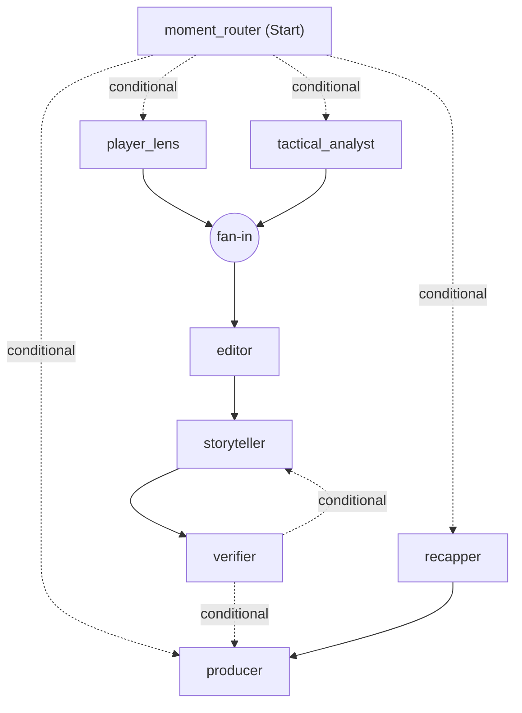

# Blindside

Explainable match intelligence for the football the camera doesn't show: off-the-ball runs, pressing
and space, linked to the passes and shots they cause. Built for the Microsoft x Premier League
*Inside the Game* hackathon. All data is synthetic and every club and player is fictional.

## Status

| Part | State |
| --- | --- |
| Data contracts (`src/blindside/contracts.py`) | Done: events, tracking, metadata, hidden truth, patterns, insights, overlay packets, viewer profiles |
| Simulator v1 (`src/blindside/sim`) | Done: 22 agents at 10 Hz, passing, shots, offside, pressing, box marking, clearances, off-ball runs with decoy intent and follow/hold marking choices, fatigue, scripted scenarios |
| Stats engine (`src/blindside/stats`) | Done for v1: event-based possession, kinematics, team shape, pitch control, off-ball runs with follower, dragging and decoy detection, pressing shifts, counter-pressing, recovery runs, line movements, gaps between the lines, overloads, pass difficulty and xG models, speed and distance triggers, fatigue, shot chains, control vs chaos, momentum swings, evaluation against hidden truth |
| Insight crew (`src/blindside/insights`) | Done as an Agent Framework workflow on Microsoft Foundry: tactical analyst and player lens explain each moment with read-only stats tools, storyteller writes every persona and language, verifier checks every explanation and line, recapper writes half-time and full-time panels, producer schedules what airs. Every model step has a deadline and a template fallback |
| Live broadcast server (`src/blindside/live`) | Done: one broadcast per match and room on a shared clock, the crew running beside it, REST API and WebSockets |
| App (`web`) | Done: one screen with Fan, Analyst, Player focus and Producer views in English, Spanish and Estonian, plus a clean overlay for OBS or vMix |
| Azure deployment, tracing and evaluations | Next |

## Run the simulator

```bash
uv sync
uv run blindside-sim --seed 58 --home HAR --away RED --scenario the_press --out data/matches/m_0058
```

Writes `events.jsonl`, `tracking.jsonl` (10 Hz), `metadata.json` and `truth.json` (hidden tactics, run
intents, marking choices, fatigue) and prints a box score. Clubs: `HAR` Harbour FC, `RED` Redwood
Athletic, `IRO` Ironvale Town, `LAR` Larkspur United. Scenarios: `free`, `the_press`, `the_decoy`,
`the_fade`.

## Realism (version 1)

Averages from a few seeds, against approximate top-flight ranges:

| Metric | Simulator | Target |
| --- | --- | --- |
| Goals per match | about 3 | 2.5 to 3.0 |
| Shots per team | 10 to 21 | 10 to 15 |
| Passes per team | 330 to 385 | 400 to 600 |
| Pass completion | 66% to 75% | 75% to 88% |
| Distance per outfield player | 10.7 to 11.1 km | 10 to 12 km |
| Top speed | 32 to 33 km/h | 33 to 36 km/h |
| Ball in play | 65 to 71 min | 55 to 60 min |

Known gaps: slightly too few passes and fouls, the ball is in play a little long, no cards or
substitutions yet.

## Analyse a match

```bash
uv run python -m blindside.sim.batch --first-seed 100 --count 12 --scenarios free,the_press,the_decoy,the_fade
uv run blindside-analyse data/league/m_0102 --eval
uv run python -m blindside.stats.evaluate data/league
```

`blindside-analyse` writes `patterns.jsonl` and `metrics.json` next to the match. Retrain the pass and xG models with
`uv run python -m blindside.stats.train data/league`. The evaluation reads `truth.json` and is the only code
that does.

## The insight crew

The crew is a Microsoft Agent Framework workflow that runs as the match plays. The moment router fans detected
patterns out to the tactical analyst and the player lens. Both are Foundry agents: they read a moment, call
read-only stats tools (match state, pressing windows, recent patterns, player summary, shot chain) that only see the
match up to that moment, and explain what happened, why, and what it led to. The editor joins their drafts and drops
repeats, the storyteller agent writes every persona and language, the verifier checks every explanation and line
(numbers may be rounded from the facts or tool results, never invented; only players in the facts or tool results
may be named) and sends failed lines back for a rewrite, the recapper agent writes the half-time and full-time
panels from what aired, and the producer schedules it all.

Every model step has a deadline. A missed deadline, a model error, a rejected explanation or a third rejected line
falls back to a template, so something accurate always airs on time. The workflow checkpoints at every superstep.



## Generate insights

```bash
cp .env.example .env    # then set your Foundry project endpoint
az login
uv run blindside-insights data/league/m_0106 --model
```

Writes `insights.jsonl` (each insight with its explanation and the tools the agent called), `variants.jsonl` (every
line per persona and language, with its source), `packets.jsonl` (timed overlays) and `crew.json` (rejections,
fallbacks, timings, model calls, tokens and cost). Model answers are cached in `cache.json` next to the match, so a
replay or a live broadcast of an analysed match costs nothing. Sign-in is keyless: the Azure CLI login locally and a
managed identity in Azure. Without `--model` the crew runs on templates only.

Run with `--unreliable 0.3` to make the storyteller misquote numbers and watch the verifier catch them, or with
`--checkpoints <folder>` to keep checkpoints on disk. `--graph` prints the workflow as the diagram above.

Across the 12 league matches with `gpt-5-mini`: 468 insights, 91% explained by the model, 3,361 of 3,363 lines
written by the model, 81 lines caught by the verifier, 2 template fallbacks, 1,060 model calls, $1.36 in total.

## Run the app

```bash
uv run blindside-serve --data data/league
npm --prefix web install
npm --prefix web run dev
```

Open http://localhost:5173, pick a match and press play. One broadcast clock drives four views:

- **Fan**: the match with graphics for casual viewers, your club's story, momentum and a catch-up
- **Analyst**: every moment with the analyst's explanation (what happened, why, what it led to), its signals,
  confidence, who wrote it, and a replay of the evidence
- **Player focus**: one player's running, off-ball and on-ball numbers, their moments, and lines written about them
- **Producer**: the rundown with each insight's reasoning and the tools behind it, approve before air, a kill switch,
  per-type switches, a switch that cuts the model (templates keep airing), injected storyteller errors, and each
  agent's runs, model calls, cache hits and credit used

Each browser gets its own broadcast room, so viewers do not share a clock unless they share a `room` in the URL.
`?view=overlay&room=<room>` is a transparent 1920 x 1080 overlay for OBS or vMix. For a single server, build the app
with `npm --prefix web run build` and `blindside-serve` serves `web/dist` itself on port 8000.

## Detection quality (12 simulated matches)

| Measure | Score |
| --- | --- |
| Off-ball runs found (recall / precision) | 68% / 78% |
| Following defender named correctly | 76% |
| Exploited decoys flagged | 55% |
| Scripted pressing changes detected | 4 of 5, median delay about 8 minutes |
| Pass completion model (train AUC) | 0.80 |
| xG model (train AUC) | 0.65 |

## Tests

```bash
uv run pytest
```
