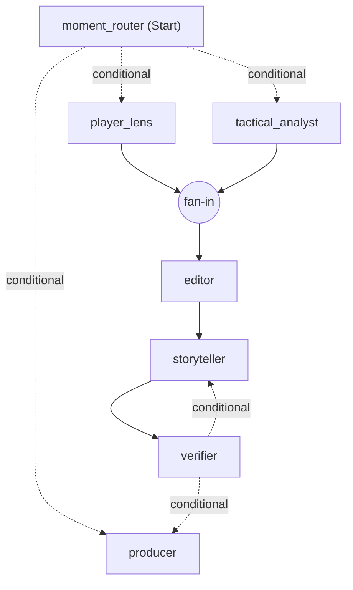

# Blindside

Explainable match intelligence for the football the camera doesn't show: off-the-ball runs, pressing
and space, linked to the passes and shots they cause. Built for the Microsoft x Premier League
*Inside the Game* hackathon. All data is synthetic and every club and player is fictional.

## Status

| Part | State |
| --- | --- |
| Data contracts (`src/blindside/contracts.py`) | Done: events, tracking, metadata, hidden truth, patterns, insights, overlay packets, viewer profiles |
| Simulator v1 (`src/blindside/sim`) | Done: 22 agents at 10 Hz, passing, shots, offside, pressing, box marking, clearances, off-ball runs with decoy intent and follow/hold marking choices, fatigue, scripted scenarios |
| Stats engine (`src/blindside/stats`) | Done for v1: event-based possession, kinematics, team shape, pitch control, off-ball runs with follower, dragging and decoy detection, pressing shifts, counter-pressing, recovery runs, line movements, gaps between the lines, overloads, pass difficulty and xG models, speed and distance triggers, fatigue, shot chains, control vs chaos, momentum swings, evaluation against hidden truth |
| Insight crew (`src/blindside/insights`) | Done as an Agent Framework workflow, with templates: analyst, storyteller (analyst, fan and player focus in English, Spanish and Estonian), verifier, producer with timed overlay packets, half-time and full-time recaps |
| Live replay server (`src/blindside/live`) | Done: REST API and a WebSocket that streams tracking frames and each viewer's overlays on the match clock, with seek, speed and live profile changes |
| Fan app and broadcast overlay (`web`) | Done: animated pitch, lower thirds, player tags, pass and shot cards, run trails, "Why?" replays, control vs chaos, momentum, player focus, catch-up, timeline, English, Spanish and Estonian |
| Microsoft Foundry, Agent Framework and Azure deployment | After the app |

## Run the simulator

```bash
uv sync
uv run blindside-sim --seed 58 --home HAR --away RED --scenario the_press --out data/matches/m_0058
```

Writes `events.jsonl`, `tracking.jsonl` (10 Hz), `metadata.json` and `truth.json` (hidden tactics, run
intents, marking choices, fatigue) and prints a box score. Clubs: `HAR` Harbour FC, `RED` Redwood
Athletic, `IRO` Ironvale Town, `LAR` Larkspur United. Scenarios: `free`, `the_press`, `the_decoy`,
`the_fade`.

## Realism (version 1)

Averages from a few seeds, against approximate top-flight ranges:

| Metric | Simulator | Target |
| --- | --- | --- |
| Goals per match | about 3 | 2.5 to 3.0 |
| Shots per team | 10 to 21 | 10 to 15 |
| Passes per team | 330 to 385 | 400 to 600 |
| Pass completion | 66% to 75% | 75% to 88% |
| Distance per outfield player | 10.7 to 11.1 km | 10 to 12 km |
| Top speed | 32 to 33 km/h | 33 to 36 km/h |
| Ball in play | 65 to 71 min | 55 to 60 min |

Known gaps: slightly too few passes and fouls, the ball is in play a little long, no cards or
substitutions yet.

## Analyse a match

```bash
uv run python -m blindside.sim.batch --first-seed 100 --count 12 --scenarios free,the_press,the_decoy,the_fade
uv run blindside-analyse data/league/m_0102 --eval
uv run python -m blindside.stats.evaluate data/league
```

`blindside-analyse` writes `patterns.jsonl` and `metrics.json` next to the match. Retrain the pass and xG models with
`uv run python -m blindside.stats.train data/league`. The evaluation reads `truth.json` and is the only code
that does.

## The insight crew

The crew is a Microsoft Agent Framework workflow that runs once per match minute. The router fans patterns out to
the tactical analyst and the player lens, the editor joins their drafts and drops repeats, the storyteller writes
every persona and language, the verifier checks each line and sends failures back for a rewrite (falling back to the
template after three attempts), and the producer schedules what airs. The workflow checkpoints at every superstep.



Run with `--unreliable 0.3` to make the storyteller misquote numbers and watch the verifier catch them, or with
`--checkpoints <folder>` to keep checkpoints on disk. `crew.json` records rejections, fallbacks and timings per agent.

## Generate insights

```bash
uv run blindside-insights data/league/m_0106
```

Writes `insights.jsonl`, `variants.jsonl` (every line per persona and language) and `packets.jsonl` (timed overlays).
Every line is checked against the facts it was built from before it is scheduled.

## Run the app

```bash
uv run blindside-serve --data data/league
npm --prefix web install
npm --prefix web run dev
```

Open http://localhost:5173. Add `?match=m_0106&view=overlay` for the transparent 1920 x 1080 broadcast overlay, which
can be used as a browser source in OBS. For a single server, build the app with `npm --prefix web run build` and
`blindside-serve` serves `web/dist` itself on port 8000.

## Detection quality (12 simulated matches)

| Measure | Score |
| --- | --- |
| Off-ball runs found (recall / precision) | 68% / 78% |
| Following defender named correctly | 76% |
| Exploited decoys flagged | 55% |
| Scripted pressing changes detected | 4 of 5, median delay about 8 minutes |
| Pass completion model (train AUC) | 0.80 |
| xG model (train AUC) | 0.65 |

## Tests

```bash
uv run pytest
```
