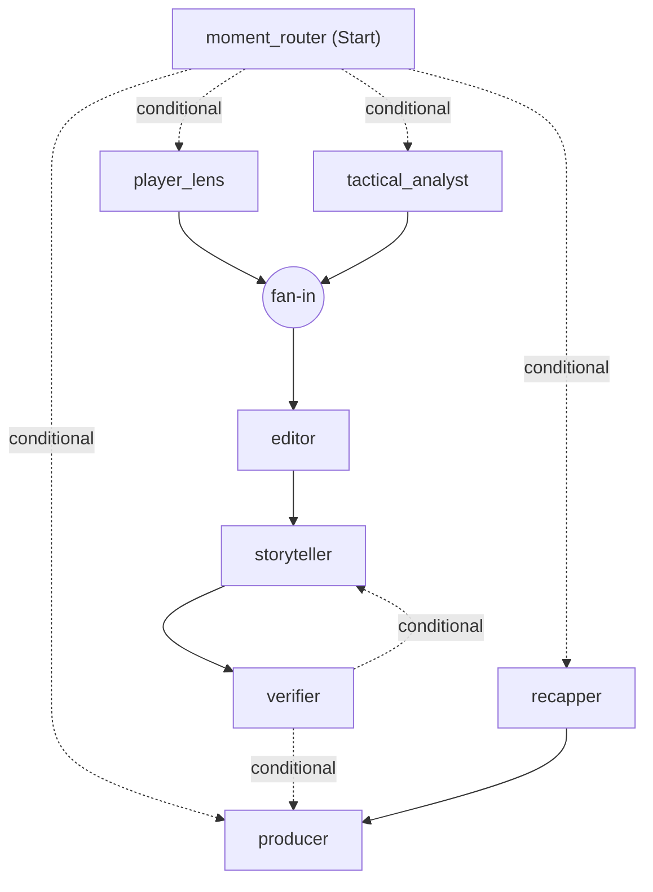

# Databall Live

Explainable match intelligence for the football the camera doesn't show: off-the-ball runs, pressing
and space, linked to the passes and shots they cause. Built for the Microsoft x Premier League
*Inside the Game* hackathon. All data is synthetic and every club and player is fictional.

**Live demo:** https://databall-live.purplegrass-00b787a0.swedencentral.azurecontainerapps.io

Try this: pick "Larkspur United v Harbour FC · The decoy", drag the timeline to the 40th minute and press play at 5x.
On **Fan**, answer a live prediction and open Replay on a card; on **Analyst**, press "See it on the pitch"; switch
to ES or ET; on **Producer**, switch to "Approve before air" or cut the model and watch templates keep airing. Each
browser gets its own broadcast, so judges do not share a clock. On the fan phone, **Match** has the live text and the
shot, pass, dribble, decoy run, pressing, attack, duel and defending maps, **Fantasy** scores every player live (star your
own players), and **Predict & win** ranks everyone in the room on the polls. The room is seeded with a simulated crowd, so
a lone viewer still has rivals. On **Player**, the player cam follows the chosen player.

## How it answers the brief

| Brief | Where it lives |
| --- | --- |
| (a) Ingest events as they happen | The live session plays each match on a clock and streams every pass, shot, tackle, recovery, pressure and possession change to the **Input** panel, beside the 22-player tracking on a 3D broadcast camera |
| (b) Interpret into statistics and patterns | The stats engine (runs, decoys, pressing, gaps, overloads, chains, pitch control, xPass, xG) streams its detections next to the events; live pass accuracy, pass difficulty, ball and shot speed, sprints and distance; every match compared with the season so far |
| (c) Explain why a moment matters | Foundry agents explain each moment with read-only stats and season tools, and every insight opens a 3D scene measured on the tracking: press density, support, block depth and open outlets, the decoy run and the space it opens, both defensive lines, the ball's path |
| (d) Render on screen | Live text commentary built from the events with the insights mixed in, event maps per team, timed, machine-readable overlay packets (shown raw in the producer console), lower thirds, player tags, pass and shot cards, a clean overlay for OBS or vMix, and producer approval before air |
| (e) Personalise | Fan, analyst, player focus and producer outputs, favourite club, followed player with a player cam, a single followed metric, three languages, density, live fantasy points for your own players, yes or no polls settled by the match with a room leaderboard and club prizes, replays and reposts |
| Player identification | Name tags on the camera, speed and distance tags when thresholds are crossed |
| Pass quality and speed | Pass distance, accuracy and a 0 to 10 difficulty rating; ball and shot speed |
| Narratives and recaps | Kick-off previews, season records, half-time standouts, goals with the season tally, half-time and full-time recaps, catch-up |
| Explainability | Control vs chaos, pressing changes against the season average, momentum and a match rhythm chart |
| Data innovation | A simulator with hidden truth, 12 league matches with tracking and a season of 24 earlier rounds |
| Multi-language | English, Spanish and Estonian, written natively and checked number by number |
| Auto-eventing from video | Out of scope; the data contract carries a source field for computer-vision events as the roadmap |

## Status

| Part | State |
| --- | --- |
| Data contracts (`src/databall_live/contracts.py`) | Done: events, tracking, metadata, hidden truth, patterns, insights, overlay packets, viewer profiles |
| Simulator v1 (`src/databall_live/sim`) | Done: 22 agents at 10 Hz, passing, shots, offside, pressing, box marking, clearances, off-ball runs with decoy intent and follow/hold marking choices, fatigue, scripted scenarios |
| Stats engine (`src/databall_live/stats`) | Done for v1: event-based possession, kinematics, team shape, pitch control, off-ball runs with follower, dragging and decoy detection, pressing shifts, counter-pressing, recovery runs, line movements, gaps between the lines, overloads, pass difficulty and xG models, speed and distance triggers, fatigue, shot chains, control vs chaos, momentum swings, evaluation against hidden truth |
| Insight crew (`src/databall_live/insights`) | Done as an Agent Framework workflow on Microsoft Foundry: tactical analyst and player lens explain each moment with read-only stats tools, storyteller writes every persona and language, verifier checks every explanation and line, recapper writes half-time and full-time panels, producer schedules what airs. Every model step has a deadline and a template fallback |
| Live broadcast server (`src/databall_live/live`) | Done: one broadcast per match and room on a shared clock, the crew running beside it, REST API and WebSockets |
| App (`web`) | Done: one screen with Fan, Analyst, Player focus and Producer views in English, Spanish and Estonian, plus a clean overlay for OBS or vMix |
| Azure deployment, tracing and evaluations | Next |

## Run the simulator

```bash
uv sync
uv run databall-sim --seed 58 --home HAR --away RED --scenario the_press --out data/matches/m_0058
```

Writes `events.jsonl`, `tracking.jsonl` (10 Hz), `metadata.json` and `truth.json` (hidden tactics, run
intents, marking choices, fatigue) and prints a box score. Clubs: `HAR` Harbour FC, `RED` Redwood
Athletic, `IRO` Ironvale Town, `LAR` Larkspur United. Scenarios: `free`, `the_press`, `the_decoy`,
`the_fade`.

## Realism (version 1)

Averages from a few seeds, against approximate top-flight ranges:

| Metric | Simulator | Target |
| --- | --- | --- |
| Goals per match | about 3 | 2.5 to 3.0 |
| Shots per team | 10 to 21 | 10 to 15 |
| Passes per team | 330 to 385 | 400 to 600 |
| Pass completion | 66% to 75% | 75% to 88% |
| Distance per outfield player | 10.7 to 11.1 km | 10 to 12 km |
| Top speed | 32 to 33 km/h | 33 to 36 km/h |
| Ball in play | 65 to 71 min | 55 to 60 min |

Known gaps: slightly too few passes and fouls, the ball is in play a little long, no cards or
substitutions yet.

## Analyse a match

```bash
uv run python -m databall_live.sim.batch --first-seed 100 --count 12 --scenarios free,the_press,the_decoy,the_fade
uv run databall-analyse data/league/m_0102 --eval
uv run python -m databall_live.stats.evaluate data/league
```

`databall-analyse` writes `patterns.jsonl`, `metrics.json` and `summary.json` (team and player numbers) next to the
match. Retrain the pass and xG models with
`uv run python -m databall_live.stats.train data/league`. The evaluation reads `truth.json` and is the only code
that does.

## The season so far

Insights compare every match with the ones played before it. The earlier rounds are simulated and analysed once, and
only their summaries are kept:

```bash
uv run python -m databall_live.sim.batch --first-seed 1 --count 24 --scenarios free,the_press,free,the_decoy,free,the_fade --out data/season
ls -d data/season/m_* | xargs -P 6 -I{} sh -c 'uv run databall-analyse {} && rm {}/tracking.jsonl'
```

For a league match, the season is every summary in `data/season` and every earlier match in its own league. A live
broadcast never sees a match that comes after it. The season gives averages, bests, totals, league ranks, form and the
last meeting.

## The insight crew

The crew is a Microsoft Agent Framework workflow that runs as the match plays. The moment router fans detected
patterns out to the tactical analyst and the player lens. Both are Foundry agents: they read a moment, call
read-only stats tools (match state, pressing windows, recent patterns, player summary, shot chain) that only see the
match up to that moment, and explain what happened, why, and what it led to. The editor joins their drafts and drops
repeats, the storyteller agent writes every persona and language, the verifier checks every explanation and line
(numbers may be rounded from the facts or tool results, never invented; only players in the facts or tool results
may be named) and sends failed lines back for a rewrite, the recapper agent writes the half-time and full-time
panels from what aired, and the producer schedules it all.

With the season, the crew also writes a kick-off preview (last meeting, form and the off-ball specialist to watch),
season-best and league-best sprints, the most decoy runs in a game this season, half-time standouts (players well
above their usual pace), pressing against the club's season average, decoy runs with season totals and league rank,
and goals with the scorer's season tally and the score. The analyst agents have a season tool for the same numbers,
and the verifier checks them like any other.

Every model step has a deadline. A missed deadline, a model error, a rejected explanation or a third rejected line
falls back to a template, so something accurate always airs on time. The workflow checkpoints at every superstep.



## Generate insights

```bash
cp .env.example .env    # then set your Foundry project endpoint
az login
uv run databall-insights data/league/m_0106 --model
```

Writes `insights.jsonl` (each insight with its explanation and the tools the agent called), `variants.jsonl` (every
line per persona and language, with its source), `packets.jsonl` (timed overlays) and `crew.json` (rejections,
fallbacks, timings, model calls, tokens and cost). Model answers are cached in `cache.json` next to the match, so a
replay or a live broadcast of an analysed match costs nothing. Sign-in is keyless: the Azure CLI login locally and a
managed identity in Azure. Without `--model` the crew runs on templates only.

Run with `--unreliable 0.3` to make the storyteller misquote numbers and watch the verifier catch them, or with
`--checkpoints <folder>` to keep checkpoints on disk. `--graph` prints the workflow as the diagram above.

Across the 12 league matches with `gpt-5-mini`, with the season context and explanations in all three languages: 504
insights (including 11 previews, 10 records and 14 half-time standouts), 459 explained by the model in English,
Spanish and Estonian, 3,732 of 3,789 lines written by the model, the rest verified templates after the verifier
rejected a draft three times.

## Run the app

```bash
uv run databall-serve --data data/league
npm --prefix web install
npm --prefix web run dev
```

Open http://localhost:5173, pick a match and press play. The screen is split in two. **Input** on the left is the
match through a 3D broadcast camera that pans with play (switch on names to tag every player), with the incoming
events and the detections streaming underneath. **Output** on the right is what Databall Live makes of it for the
chosen view, all on one broadcast clock:

- **Fan**: the fan web app. Insights pop up as they happen, with their own look for goals, records, standouts and the
  preview. Each can be replayed as a 3D scene in the app or reposted as a branded image to Instagram, Facebook or X.
  Live predictions open when a club gets on top and are settled by the match, with points and a streak. Follow a club,
  follow one metric (speed, off-ball runs, pressing, chances or passing) with a live tracker, catch up
- **Analyst**: the match rhythm, live pass quality and speeds, both clubs against their season pace with form, and
  every moment explained: what happened, why, what it led to, the evidence, confidence and who wrote it. "See it on the
  pitch" opens the 3D explainer scene for that moment
- **Player focus**: the same app following one player: today against the season average and best, season totals and
  league rank, their moments, and the lines written about them
- **Producer**: the graphics on air, the machine-readable packet behind them, season talking points, approve before
  air, a kill switch, per-type switches, a switch that cuts the model, injected storyteller errors, the rundown with
  each insight's reasoning and tools, and each agent's runs, model calls, cache hits and credit used

Viewers who join late, switch view or skip ahead get every graphic that already aired for them, so jumping to the 40th
minute fills the feed with the first 39. The app follows the system light
or dark setting and has a switch for both.

Each browser gets its own broadcast room, so viewers do not share a clock unless they share a `room` in the URL.
`?view=overlay&room=<room>` is a transparent 1920 x 1080 overlay for OBS or vMix. For a single server, build the app
with `npm --prefix web run build` and `databall-serve` serves `web/dist` itself on port 8000.

## Deploy to Azure

The app runs as one container on Azure Container Apps (one always-on replica, so live sessions and WebSockets stay
on one process), pulled from Azure Container Registry. Its managed identity has Cognitive Services User on the
Foundry resource, so there are no keys. The image carries the 12 analysed matches with their cached model answers,
so a judge's broadcast costs almost nothing and only uncached moments call the model.

```bash
az acr login -n <registry>
docker buildx build --platform linux/amd64 -t <registry>.azurecr.io/databall-live:v2 --push .
az containerapp update -n databall-live -g <resource-group> --image <registry>.azurecr.io/databall-live:v2
```

The image is built locally because free-trial subscriptions cannot run ACR Tasks.

## Detection quality (12 simulated matches)

| Measure | Score |
| --- | --- |
| Off-ball runs found (recall / precision) | 68% / 78% |
| Following defender named correctly | 76% |
| Exploited decoys flagged | 55% |
| Scripted pressing changes detected | 4 of 5, median delay about 8 minutes |
| Pass completion model (train AUC) | 0.80 |
| xG model (train AUC) | 0.65 |

## Tests

```bash
uv run pytest
```
